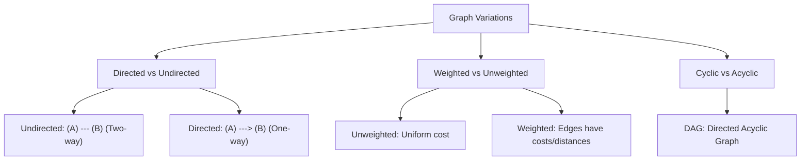
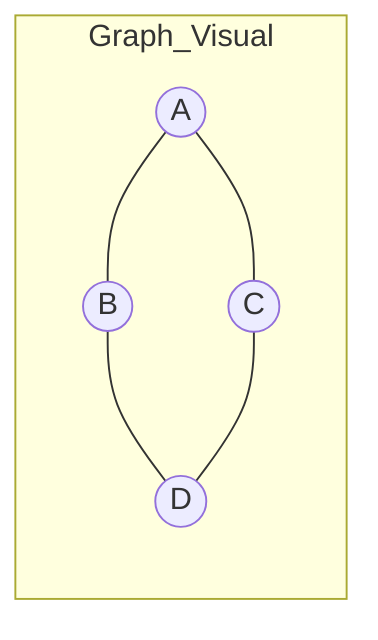
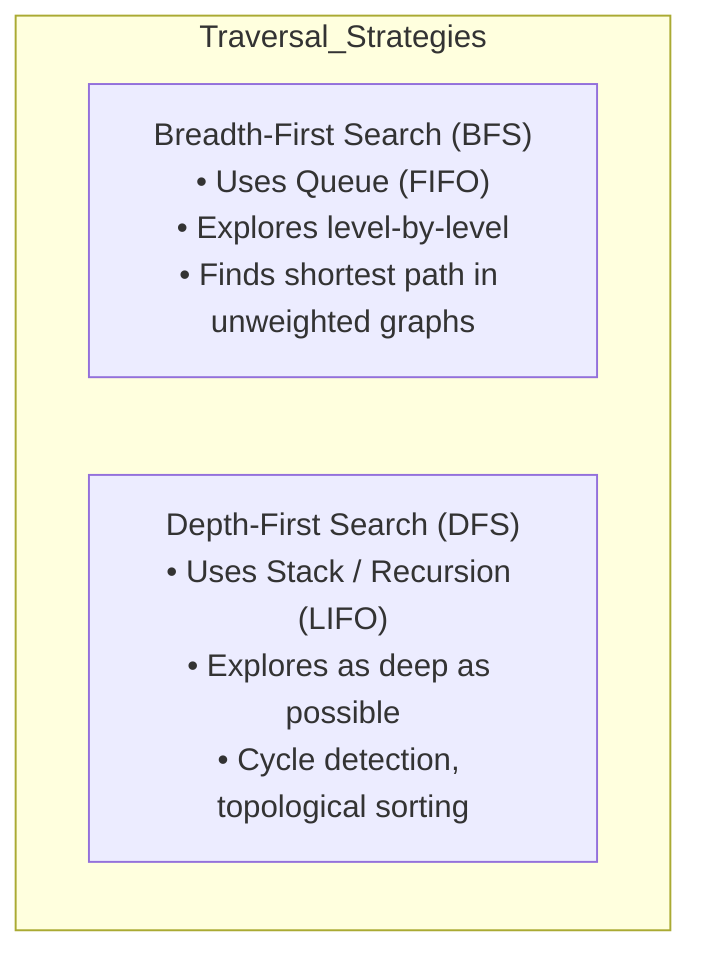

# 🕸️ Graph Data Structure

A **Graph** is a non-linear data structure consisting of a finite set of **Vertices (or Nodes)** and a collection of **Edges** that connect pairs of vertices.

$$G = (V, E)$$
Where:
- $V$: Set of vertices
- $E$: Set of edges connecting pairs of vertices $(u, v)$

---

## ⚙️ Types of Graphs



---

## 📊 Representations: Adjacency List vs Adjacency Matrix



### 1. Adjacency List (Used in our implementation)
Each vertex stores a list of adjacent vertices. Ideal for sparse graphs.
```javascript
{
  "A": ["B", "C"],
  "B": ["A", "D"],
  "C": ["A", "D"],
  "D": ["B", "C"]
}
```

### 2. Adjacency Matrix
A 2D array of size $|V| \times |V|$ where `matrix[i][j] = 1` indicates an edge.
| | A | B | C | D |
|---|---|---|---|---|
| **A** | 0 | 1 | 1 | 0 |
| **B** | 1 | 0 | 0 | 1 |
| **C** | 1 | 0 | 0 | 1 |
| **D** | 0 | 1 | 1 | 0 |

---

## 🔄 Graph Traversals: BFS vs DFS



### 1. Breadth-First Search (BFS)
Visits all neighbors of a node before moving to their neighbors.
- **Data Structure**: Queue
- **Application**: Shortest path in unweighted graphs, peer-to-peer networks, web crawlers.

### 2. Depth-First Search (DFS)
Follows a branch as deep as possible before backtracking.
- **Data Structure**: Stack (or Call Stack via recursion)
- **Application**: Maze solving, topological sort, finding strongly connected components, cycle detection.

---

## 🚀 Complexity Analysis

| Operation | Adjacency List | Adjacency Matrix |
| :--- | :--- | :--- |
| **Space** | **O(\|V\| + \|E\|)** | O(\|V\|²) |
| **Add Vertex** | **O(1)** | O(\|V\|²) |
| **Add Edge** | **O(1)** | O(1) |
| **Remove Vertex** | **O(\|V\| + \|E\|)** | O(\|V\|²) |
| **Remove Edge** | **O(\|E\|)** | O(1) |
| **Query Edge $(u, v)$** | **O(degree(u))** | O(1) |
| **BFS / DFS** | **O(\|V\| + \|E\|)** | O(\|V\|²) |

---

## 💻 Implementation Snippet

```javascript
class Graph {
  constructor() {
    this.adjacencyList = {};
  }

  addVertex(vertex) {
    if (!this.adjacencyList[vertex]) this.adjacencyList[vertex] = [];
  }

  addEdge(v1, v2, isDirected = false) {
    if (!this.adjacencyList[v1]) this.addVertex(v1);
    if (!this.adjacencyList[v2]) this.addVertex(v2);

    this.adjacencyList[v1].push(v2);
    if (!isDirected) {
      this.adjacencyList[v2].push(v1);
    }
  }

  bfs(startVertex) {
    const queue = [startVertex];
    const visited = { [startVertex]: true };
    const result = [];

    while (queue.length > 0) {
      const current = queue.shift();
      result.push(current);

      for (const neighbor of this.adjacencyList[current] || []) {
        if (!visited[neighbor]) {
          visited[neighbor] = true;
          queue.push(neighbor);
        }
      }
    }
    return result;
  }
}
```

---

[⬅️ Back to README](README.md)

## 👨‍💻 Author
**Ahmed GH Tarek**  
[GitHub Profile](https://github.com/ahmedGHtarek0)
