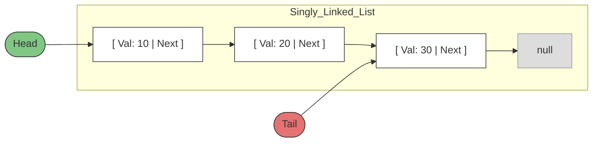
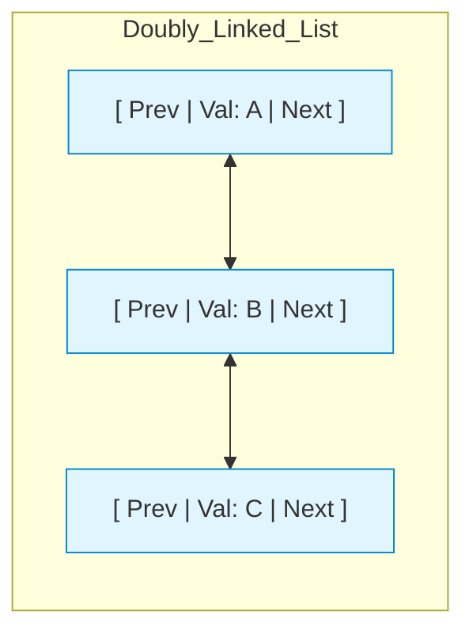

# 🔗 Linked List Data Structure

A **Linked List** is a linear data structure where elements (called **nodes**) are not stored at contiguous memory locations. Instead, each node contains a **data value** and a **pointer (or reference)** to the next node in the sequence.

---

## ⚙️ How it Works

Unlike arrays where elements are stored contiguously and resized dynamically, linked lists allocate memory dynamically for each node independently.

### 1. Singly Linked List
Each node points only to the next node. The last node points to `null`.



### 2. Doubly Linked List
Each node maintains two references: one pointing forward to `next`, and one pointing backward to `prev`.



---

## ⚖️ Array vs Linked List Comparison

| Feature | Dynamic Array | Linked List |
| :--- | :--- | :--- |
| **Access by Index (`O(1)`)** | ✅ Direct index math | ❌ Requires O(n) traversal |
| **Insertion / Deletion at Start** | ❌ O(n) due to shifting | ✅ O(1) by updating head |
| **Insertion / Deletion at End** | ✅ Amortized O(1) | ✅ O(1) (with tail pointer) |
| **Memory Allocation** | Contiguous chunk | Dispersed nodes with pointer overhead |
| **Dynamic Resizing** | Reallocates and copies array | Creates node on demand |

---

## 🚀 Operations & Complexity

| Method | Description | Time Complexity | Space Complexity |
| :--- | :--- | :--- | :--- |
| `prepend(value)` | Inserts node at the head of the list. | **O(1)** | O(1) |
| `append(value)` | Appends node at the tail of the list. | **O(1)** | O(1) |
| `insertAt(index, val)` | Inserts node at a given index. | **O(n)** | O(1) |
| `shift()` | Removes the head node. | **O(1)** | O(1) |
| `pop()` | Removes the tail node (Singly). | **O(n)** | O(1) |
| `remove(value)` | Removes node with target value. | **O(n)** | O(1) |
| `get(index)` | Retrieves node at index. | **O(n)** | O(1) |
| `reverse()` | Reverses the list in-place. | **O(n)** | O(1) |

---

## 💻 Implementation Snippet

```javascript
class Node {
  constructor(value) {
    this.value = value;
    this.next = null;
  }
}

class SinglyLinkedList {
  constructor() {
    this.head = null;
    this.tail = null;
    this.length = 0;
  }

  append(value) {
    const newNode = new Node(value);
    if (!this.head) {
      this.head = newNode;
      this.tail = newNode;
    } else {
      this.tail.next = newNode;
      this.tail = newNode;
    }
    this.length++;
  }

  prepend(value) {
    const newNode = new Node(value);
    if (!this.head) {
      this.head = newNode;
      this.tail = newNode;
    } else {
      newNode.next = this.head;
      this.head = newNode;
    }
    this.length++;
  }
}
```

---

[⬅️ Back to README](README.md)

## 👨‍💻 Author
**Ahmed GH Tarek**  
[GitHub Profile](https://github.com/ahmedGHtarek0)
