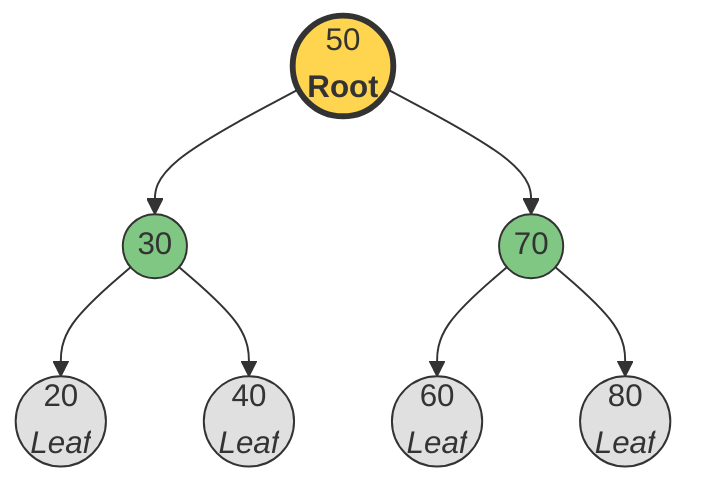
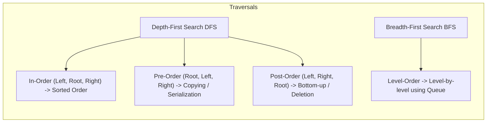

# 🌲 Binary Search Tree (BST) Data Structure

A **Tree** is a non-linear, hierarchical data structure composed of nodes connected by edges. A **Binary Tree** is a tree where each node has at most two children: a **left child** and a **right child**.

A **Binary Search Tree (BST)** enforces the **BST Invariant**:
- Every node in the **left subtree** has a key strictly less than the node's key: $\text{Left} < \text{Root}$
- Every node in the **right subtree** has a key strictly greater than the node's key: $\text{Right} > \text{Root}$

---

## ⚙️ Tree Structure & Anatomy



---

## 🔄 Tree Traversals

Traversals determine the order in which each node in the tree is visited.



### Visualizing Traversals for Sample Tree:
Tree nodes: `[50, 30, 70, 20, 40, 60, 80]`

| Traversal | Order of Visiting | Output for Example |
| :--- | :--- | :--- |
| **In-Order** | Left Subtree $\rightarrow$ Root $\rightarrow$ Right Subtree | `[20, 30, 40, 50, 60, 70, 80]` *(Ascending Sorted)* |
| **Pre-Order** | Root $\rightarrow$ Left Subtree $\rightarrow$ Right Subtree | `[50, 30, 20, 40, 70, 60, 80]` |
| **Post-Order** | Left Subtree $\rightarrow$ Right Subtree $\rightarrow$ Root | `[20, 40, 30, 60, 80, 70, 50]` |
| **Level-Order** | Level 0 $\rightarrow$ Level 1 $\rightarrow$ Level 2 (BFS) | `[50, 30, 70, 20, 40, 60, 80]` |

---

## 🗑️ Deletion Cases in BST

When removing a node from a BST, three cases must be considered:

1. **Leaf Node (0 children)**: Simply detach the node from its parent.
2. **Node with 1 child**: Replace the node with its only child.
3. **Node with 2 children**:
   - Find the **in-order successor** (the smallest node in its right subtree) or in-order predecessor.
   - Copy the successor's value into the target node.
   - Delete the successor node from the right subtree.

---

## 🚀 Complexity Analysis

| Operation | Average Case | Worst Case (Skewed Tree) | Space Complexity |
| :--- | :--- | :--- | :--- |
| **Search** | **O(log n)** | **O(n)** | O(1) iterative / O(h) recursive |
| **Insertion** | **O(log n)** | **O(n)** | O(1) iterative / O(h) recursive |
| **Deletion** | **O(log n)** | **O(n)** | O(h) recursion stack |
| **Traversals** | **O(n)** | **O(n)** | O(n) |

> *Note: Balanced BST variants (like AVL Trees or Red-Black Trees) guarantee $O(\log n)$ even in the worst case by self-balancing.*

---

## 💻 Implementation Snippet

```javascript
class TreeNode {
  constructor(value) {
    this.value = value;
    this.left = null;
    this.right = null;
  }
}

class BinarySearchTree {
  constructor() {
    this.root = null;
  }

  insert(value) {
    const newNode = new TreeNode(value);
    if (!this.root) {
      this.root = newNode;
      return this;
    }
    let current = this.root;
    while (true) {
      if (value === current.value) return undefined;
      if (value < current.value) {
        if (!current.left) {
          current.left = newNode;
          return this;
        }
        current = current.left;
      } else {
        if (!current.right) {
          current.right = newNode;
          return this;
        }
        current = current.right;
      }
    }
  }

  inOrder(node = this.root, result = []) {
    if (node) {
      this.inOrder(node.left, result);
      result.push(node.value);
      this.inOrder(node.right, result);
    }
    return result;
  }
}
```

---

[⬅️ Back to README](README.md)

## 👨‍💻 Author
**Ahmed GH Tarek**  
[GitHub Profile](https://github.com/ahmedGHtarek0)
